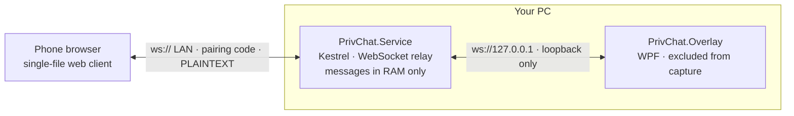

# PrivChat

**Text your own PC from your phone, over your own Wi-Fi, through nobody's server — on a window that does not appear in screenshots or screen shares.**


PrivChat is a two-part experiment in **local-only messaging with a capture-resistant UI**. A tiny Windows service runs a chat relay on your LAN; your phone joins it from a browser with a pairing code; the PC side is a WPF overlay that Windows itself excludes from screen capture.

No account. No cloud. No database. No telemetry. Messages live in RAM and die with the process.

---

## The research question

Screen sharing and screenshots are now the default way software leaks information. You share a tab, and a notification toast reveals a message. You screen-record a bug, and a chat window is in frame. Cloud chat apps add a second problem: a third party holds the transcript.

PrivChat asks what falls out if you push both problems down to the operating system and the local network:

1. **Can a chat window be structurally absent from capture** rather than merely "hidden" by the user? Windows exposes `SetWindowDisplayAffinity(WDA_EXCLUDEFROMCAPTURE)`, which makes the compositor omit a window from capture APIs — screenshots, screen recorders and screen-sharing tools see through it, while your eyes do not.
2. **How little infrastructure does a private channel actually need?** Answer: one process, one port, no storage, and a six-digit code.

The result is small enough to read end to end — about 900 lines of C# plus a single-file web client — which is the point. A privacy claim you cannot audit is a marketing claim.

---

## Threat model

Privacy tools are only meaningful against a stated adversary. Here is the honest split.

### What PrivChat protects against

| Threat | How |
| --- | --- |
| Screenshots, screen recorders, screen sharing (Zoom/Teams/Meet/OBS) | `WDA_EXCLUDEFROMCAPTURE` — the compositor omits the overlay from captured frames |
| Third-party servers holding your messages | There is no server but your own PC; the process makes zero outbound connections |
| Message history on disk | Messages are held in memory only, capped at the last 200, never written to disk |
| Log files leaking content | All logging providers are removed. Only crash text is ever written to disk |
| The window showing up in the taskbar or Alt+Tab | `WS_EX_TOOLWINDOW`, `ShowInTaskbar="False"` |
| Another device on your Wi-Fi joining the chat | Six-digit pairing code, regenerated on every service start, constant-time compare, 20 failures per IP per 10 minutes then lockout |
| A remote host reading the pairing code or driving the PC side | `/api/local-info` and the `overlay` WebSocket role are refused for any non-loopback address |

### What PrivChat does **not** protect against

| Threat | Why |
| --- | --- |
| **Anyone sniffing your LAN** | **Traffic is plaintext HTTP/WebSocket. No TLS. A packet capture on the same network reveals every message and the pairing code itself.** This is the single biggest limitation — see [Limitations](#limitations) |
| Malware, keyloggers or a screen-scraping RAT on the PC | Display affinity is a compositor feature, not a sandbox. Code running on your machine can read the window's contents from process memory |
| A phone camera pointed at your monitor | Nothing stops photons |
| Hardware capture cards and some virtual-display setups | They capture below the compositor. The code falls back to `WDA_MONITOR` where exclusion is unsupported |
| Patient brute force of the pairing code | The lockout is per source IP and the window resets, so a distributed or slow attacker still has a path through a six-digit space |
| A newly paired device seeing recent history | Pairing replays the last 200 messages by design, so your phone can pick up mid-conversation |
| Anything after the process exits | There is nothing to protect — the transcript is gone |

If your adversary is on your network, PrivChat is not ready for you yet. If your adversary is a screen recorder, a screenshot key, or a cloud provider, it does its job.

---

## Quickstart

Requires Windows 10 2004+ (build 19041) or Windows 11, and the [.NET 8 SDK](https://dotnet.microsoft.com/download) for the first build.

1. Double-click **`scripts\start-privchat.bat`** and approve the UAC prompt.

   On first run it builds the projects, installs the `PrivChatLocal` service, opens a firewall rule for **Private** networks, starts everything, and launches the overlay.

2. The overlay appears at the top-right of your screen showing a **six-digit code** and a URL:

   ```
   483643  http://192.168.1.50:8787
   ```

3. On your phone, on the same Wi-Fi, open that URL in a browser.

4. Enter the code, tap **Connect**, and type.

To shut everything down, double-click **`scripts\stop-privchat.bat`**. It stops the service, **disables** it so nothing can start it on boot, and kills every PrivChat process. PrivChat runs again only when you run the start script.

The pairing code is regenerated on every service start. An old code stops working after a restart — that is deliberate.

---

## How it works



**`PrivChat.Service`** — a minimal ASP.NET Core app with no controllers and no database. It serves the phone client as one embedded HTML string, relays WebSocket frames between clients, and keeps the last 200 messages in a `ConcurrentQueue`. It runs as a Windows service through a hand-rolled `StartServiceCtrlDispatcher` host, and launches the overlay into the active desktop session with `WTSQueryUserToken` + `CreateProcessAsUser`, because a service in session 0 cannot draw a window for you.

**`PrivChat.Overlay`** — a WPF window that sets `WDA_EXCLUDEFROMCAPTURE` on its own handle, marks itself a tool window so it stays out of the taskbar and Alt+Tab, pins itself topmost, and remembers where you dragged it. It talks to the relay over loopback only.

**The phone client** — one `<script>` and one `<style>` in a single HTML string. No framework, no bundler, no CDN, no fonts, no analytics. It is served with `Cache-Control: no-store` so an update is never masked by a cached page.

Roles are asymmetric on purpose: the `overlay` role is accepted only from loopback and needs no code, while the `phone` role comes from the network and must present the pairing code.

---

## Limitations

**No transport encryption.** The relay speaks plaintext HTTP and `ws://`. Messages, and the pairing code in the WebSocket query string, are readable by anything doing packet capture on your network. Treat PrivChat as safe from the *screen* and from the *cloud*, and not yet safe from the *wire*. Run it on a network you control.

Also worth knowing:

- **Windows only**, by construction — the capture exclusion is a Win32 compositor feature.
- The overlay **relaunches within five seconds** while the service is running. It is the only place the pairing code is shown, so it is deliberately hard to lose. Use the stop script to make it go away.
- **Pairing replays recent history** to a newly connected phone.
- The overlay is **elevated** if the start script has to launch it as a fallback, which restricts drag-and-drop from normal applications.
- Not audited, not hardened, not a substitute for Signal. It is a prototype for reading and tinkering with.

---

## Building and scripts

```powershell
# run in a console, no service install, Ctrl+C to stop
powershell -ExecutionPolicy Bypass -File scripts\run-dev.ps1

# check the pairing gate actually rejects wrong codes
powershell -ExecutionPolicy Bypass -File scripts\smoke-test.ps1
```

| Script | Purpose |
| --- | --- |
| `start-privchat.bat` | Self-elevating one-click start; installs on first run |
| `stop-privchat.bat` | Stops, disables, and kills everything |
| `run-dev.ps1` | Console mode for development |
| `publish.ps1` | Framework-dependent publish of both projects |
| `install-service.ps1` | Republishes, then installs the service as manual-start. **This is also the update path** — re-run it after changing code |
| `uninstall-service.ps1` | Removes the service and the firewall rule |
| `smoke-test.ps1` | Asserts a wrong pairing code is refused and the right one is accepted |

Useful flags on the service itself: `--port <n>`, `--listen <url>`, `--no-overlay`, `--overlay-path <exe>`, `--service`.

Because `install-service.ps1` points the service at the `publish\` folder, **changing code is not enough** — re-run that script so the installed binary is current.

## Repository layout

```
PrivChat.Service/     relay, Windows service host, embedded phone client
PrivChat.Overlay/     WPF overlay with capture exclusion
scripts/              start/stop, publish, install, dev, smoke test
```

## Contributing

Issues and pull requests are welcome, particularly on the honest gaps: TLS with a trust-on-first-use certificate, a real key exchange instead of a six-digit code, and a tray control so the overlay can be dismissed without stopping the service.

If you find a security flaw, please open an issue describing the attack rather than only the symptom.

## License

MIT — see [LICENSE](LICENSE).
